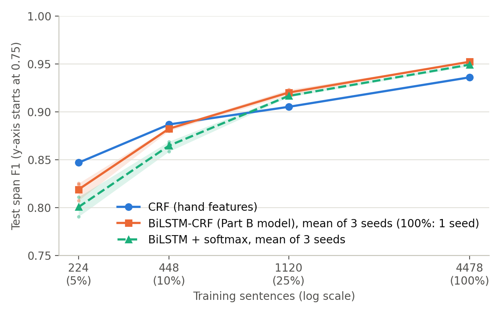

# Slot Filling: CRF vs. BiLSTM

An experimental comparison of feature-based CRFs and neural sequence taggers
on ATIS slot filling, developed by Michael Incorvaia for Conversational AI.

The experiments compare training on 5%, 10%, 25%, and 100% of the data, ablate
CRF features, and compare BiLSTM-CRF with a softmax-only BiLSTM across seeds.
The neural implementation includes CRF inference and Viterbi decoding with
illegal IOB2 transitions masked. Model code is in `models/`.



Recorded metrics and figures are in `figures/`; the report and its source are
in `report/`. Hyperparameters and early stopping were selected on validation
data; test scores are used for reporting. The constant-learning-rate recipe
avoids premature decay observed in the earlier small-data experiments.

## Setup and reproduction

```bash
conda env create -f env.yml
conda activate CAI_SO_FUN
```

Prepare ATIS as described in [data/README.md](data/README.md), then run from the repo root:

```bash
python train_all.py --models crf
python train_all.py --models bilstm --constant-lr --max-epochs 300 --patience 20
python evaluate.py --model crf --checkpoint-dir checkpoints/crf_1.00 --split test
python evaluate.py --model bilstm --checkpoint-dir checkpoints/bilstm_1.00 --split test
python crf_ablation.py
python plot_curve.py --split test
python error_analysis.py --crf-dir checkpoints/crf_1.00 --bilstm-dir checkpoints/bilstm_1.00
```

For the additional seeds and softmax comparison:

```bash
python train_all.py --models bilstm --extra --seeds 42 1 2 --fractions 0.05 0.10 0.25 --constant-lr --max-epochs 300 --patience 20
python train_all.py --models bilstm --extra --no-crf --seeds 42 --fractions 1.00 --constant-lr --max-epochs 300 --patience 20
python train_all.py --models bilstm --extra --no-crf --seeds 42 1 2 --fractions 0.05 0.10 0.25 --constant-lr --max-epochs 300 --patience 20
python plot_curve.py --split test --extras
```

Headline runs use seed 42. GPU/CPU training can differ. Checkpoints, datasets,
submission archives, and raw predictions are excluded from Git; recorded
figures and metrics are included. See [ATTRIBUTION.md](ATTRIBUTION.md).
